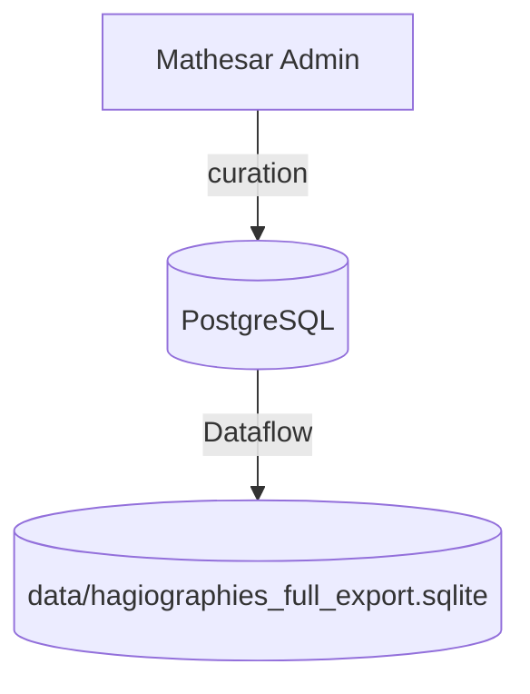

# PostgreSQL Architecture

This document describes the PostgreSQL-primary architecture of the Hagiographies project.

## 1. Current Status: PostgreSQL-Primary

- **PostgreSQL** is the single "Source of Truth", curated by researchers in Mathesar.
  `utils/utilities/src/utilities/model.py` describes the July 2026 schema; the live DB has
  since been modified and takes precedence.
- **Mathesar** is the admin UI, editing PostgreSQL directly (no separate admin database adapter to configure).
- The Excel import was a one-off initial load (July 2026) and is **obsolete**; its
  recipes have been removed. Schema changes go through `db/migrations/`
  (`just db_migrate`; see `db/README.md`).
- Production: `gcdhpsqlprd1.ugent.be` (VPN). The Docker `postgres` service is a local copy.

---

## 2. Lifecycle Commands

- **SQLite export**: `just pg_export_sqlite` dumps PostgreSQL to `data/hagiographies_full_export.sqlite` via Dataflow.
  The source DSN is set in `dataflow/config.json` (currently the local Docker `postgres`), so point it at the up-to-date DB first.

### Local vs remote database

The Python recipes (`db_diagram`, `mathesar_summaries`/`mathesar_display`) connect
to whatever
`PG_DATABASE_URL` resolves to inside the `utils` container:

- **Local Docker Postgres** (default): `dev.env` defines
  `PG_DATABASE_URL=…@postgres:5432/…` (the in-network `postgres` service).
- **Remote server**: create a local, gitignored `.env` with a remote
  `PG_DATABASE_URL=…@your-host:5432/…`. Docker Compose layers `.env` on top of
  `dev.env` for the `utils` container (`compose.yml`), so it overrides the local
  value. `utils/utilities/src/utilities/config.py` reads `DATABASE_URL` or
  `PG_DATABASE_URL`, so no explicit `-e` flag is needed.

`pg_export_sqlite` does not follow `.env`: `dataflow/config.json` hard-codes the
local `postgres:5432` DSN.

---

## 3. Data Flow



---

## 4. DevOps & Production Operations

### Persistence
The PostgreSQL data is persisted via the `postgres-data` named volume. Ensure this volume is backed up regularly.

### Performance & Optimization
- **Backups**: Use `pg_dump` within the container for snapshots:
    ```bash
    docker compose exec postgres pg_dump -U user_name db_name > backup.sql
    ```

### Connectivity
Always use the service name `postgres` as the hostname in connection strings when services are communicating within the Docker network.
